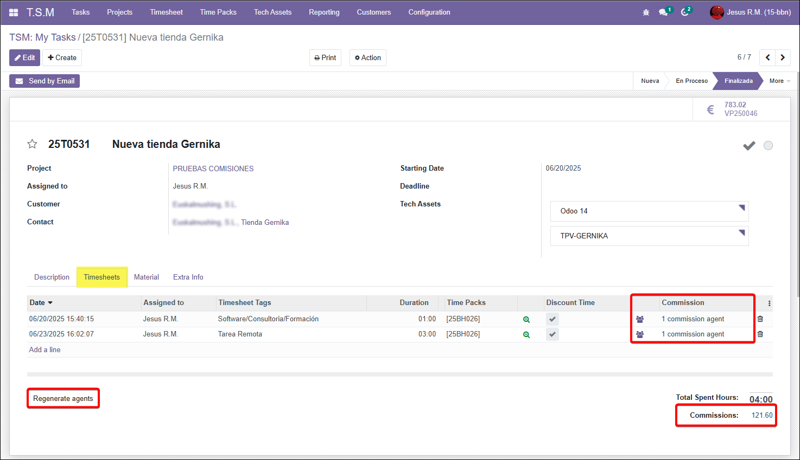

=========================
TSM Timesheet Commissions
=========================

.. 
   !!!!!!!!!!!!!!!!!!!!!!!!!!!!!!!!!!!!!!!!!!!!!!!!!!!!
   !! This file is generated by oca-gen-addon-readme !!
   !! changes will be overwritten.                   !!
   !!!!!!!!!!!!!!!!!!!!!!!!!!!!!!!!!!!!!!!!!!!!!!!!!!!!
   !! source digest: sha256:71241263af34f6642f832c00ddf8537e163c2472cffe690a40624bd05cda551a
   !!!!!!!!!!!!!!!!!!!!!!!!!!!!!!!!!!!!!!!!!!!!!!!!!!!!

.. |badge1| image:: https://img.shields.io/badge/maturity-Beta-yellow.png
    :target: https://odoo-community.org/page/development-status
    :alt: Beta
.. |badge2| image:: https://img.shields.io/badge/license-AGPL--3-blue.png
    :target: http://www.gnu.org/licenses/agpl-3.0-standalone.html
    :alt: License: AGPL-3
.. |badge3| image:: https://img.shields.io/badge/github-Bilbonet%2Fbilbonet--tsm-lightgray.png?logo=github
    :target: https://github.com/Bilbonet/bilbonet-tsm/tree/18.0/tsm_timesheet_commission
    :alt: Bilbonet/bilbonet-tsm

|badge1| |badge2| |badge3|

This module adds the function to calculate commissions in tasks with
timesheet and timepacks

It also allows to create vendor bills from settlements for external
agents.

This module depends on the commission module.

**Table of contents**

.. contents::
   :local:

Use Cases / Context
===================

In many business logic it's necessary to control commissions for
technicians.

Installation
============

No additional installation steps are required.

Configuration
=============

Configure each agent contact with its **TSM Commission** in the agent
information page. Use a commission with settlement type **Timesheet**,
an hourly product and the required percentage or sections. The general
**Commission** remains the separate default used by sales and invoice
commissions.

Select **Task Based** to settle at any task stage, or **Task Closed** to
wait for a closed stage. Set the agent's settlement period as usual in
OCA commissions. Access to commission setup and settlement actions
follows the OCA commission groups; TSM membership alone does not grant
access to those actions.

Usage
=====

1. Open a task under **T.S.M > Tasks** and add time entries. Customer
   agents are proposed using their TSM commission.
2. Use the people icon on a time entry to edit its agents and
   commissions. Commission managers can also use the additional icon for
   entries without a time pack or without consumed pack hours.
3. Automatic hourly prices use the time pack price for consumed hours
   and zero for complimentary pack hours. Without a pack, they use the
   commission's hourly product price. A nonzero specific price overrides
   automatic pricing; zero keeps automatic pricing.
4. **Regenerate agents** replaces the task's current agent assignments
   from the customer setup. Settled agents cannot be deleted or
   regenerated.

|Task with timesheet and commissions|

To settle commissions, open the OCA **Settle Commissions** action,
choose **Timesheet**, agents and the cutoff date. The wizard processes
completed settlement periods. Commissions configured for closed tasks
wait until the task is closed. Entries without a task are skipped.

Open **Commissions > Settlements** to review TSM settlements and their
source time entries. The **Invoices Settlements** list is filtered to
sales-invoice commissions and does not list TSM settlements. Cancelling
a TSM settlement makes its agent lines available for settlement again.

For external agents, use **Make invoice** on a settlement, or the OCA
**Create Commission Invoices** action, with the appropriate accounting
access. Select the purchase journal, service product, optional invoice
date and the settlements to invoice.

Assigning agents does not lock the timesheet fields controlled by this
addon. Those fields become read-only when any agent has a non-cancelled
settlement. Cancelling all settlements for the entry releases those
fields again.

Commission managers can edit TSM settlement lines in **Settled** state
and remove rows using the standard trash icon. Save the sheet to apply
the changes. Removing a settlement row preserves its time entry and
agent, updates the sheet total and leaves the source commission pending
unless it has another active settlement. Other settlement states keep
the lines read-only.

Running the settlement wizard again uses the time-entry date. It can
reinsert the commission into an eligible sheet for that period, or
create another sheet if the previous sheet has been invoiced. It does
not defer it to the following month. A time entry remains locked while
any agent has a non-cancelled settlement.

Known issues / Roadmap
======================

There are no future improvments in sight.

Changelog
=========

What's your history.

Bug Tracker
===========

Bugs are tracked on `GitHub Issues <https://github.com/Bilbonet/bilbonet-tsm/issues>`_.
In case of trouble, please check there if your issue has already been reported.
If you spotted it first, help us to smash it by providing a detailed and welcomed
`feedback <https://github.com/Bilbonet/bilbonet-tsm/issues/new?body=module:%20tsm_timesheet_commission%0Aversion:%2018.0%0A%0A**Steps%20to%20reproduce**%0A-%20...%0A%0A**Current%20behavior**%0A%0A**Expected%20behavior**>`_.

Do not contact contributors directly about support or help with technical issues.

Credits
=======

Authors
-------

* Jesus Ramiro (Bilbonet)
* 

Contributors
------------

- Jesus Ramiro jesus@bilbonet.net

Other credits
-------------

The development of this module has been financially supported by:

- Bilbonet

Maintainers
-----------

.. |maintainer-bilbonet| image:: https://github.com/bilbonet.png?size=40px
    :target: https://github.com/bilbonet
    :alt: bilbonet

Current maintainer:

|maintainer-bilbonet| 

This module is part of the `Bilbonet/bilbonet-tsm <https://github.com/Bilbonet/bilbonet-tsm/tree/18.0/tsm_timesheet_commission>`_ project on GitHub.

You are welcome to contribute.
